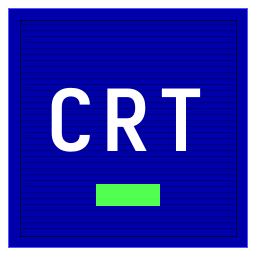

# TurboEditor1988

**TurboEditor1988** — a Kate-class text editor wearing a Borland/Turbo
Vision shell, with cool-retro-term's CRT pipeline running over the whole window.



## What it is

TurboEditor1988 is a desktop text editor built on KDE's KTextEditor engine. The
editor itself is full-featured; the shell around it is deliberately DOS-era:
blue desktop, grey panels, double-line frames, `[ ]` checkboxes, green action
plates, and a CRT glass that can add scanlines, bloom, burn-in, phosphor colour,
and a rolling sweep line across the entire interface.

## Features

- KTextEditor editing: syntax highlighting, folding, block selection, search and
  replace, sessions, autosave and crash recovery.
- Turbo Vision chrome: TV menus, tab chips, spin boxes, dropdowns, modals and
  file pickers drawn by the project's own widgets — no native file dialogs.
- Four-stage CRT pipeline (burn-in → bloom → dynamic pass → static pass) ported
  from cool-retro-term and generalised for an edge-to-edge GUI with no bezel.
- Named effect profiles: save the current look under a name, keep several, and
  switch between them from Settings → CRT.
- A master **Enable CRT effects** switch that unloads the pipeline without
  losing the selected look.
- Phosphor and background colour pickers with the house colour-picker modal.
- Settings, sessions, recents and effect profiles persist between runs.

## Build

Requirements (Fedora package names; equivalent packages work elsewhere):

- CMake ≥ 3.31 and a C++20 compiler
- Qt 6.10: `qt6-qtbase-devel`, `qt6-qtdeclarative-devel`,
  `qt6-qtshadertools` (provides `qsb`)
- KF6: `kf6-ktexteditor-devel`, `kf6-sonnet-devel`,
  `kf6-syntax-highlighting-devel`

```sh
cmake -S . -B build -DCMAKE_BUILD_TYPE=Release
cmake --build build -j"$(nproc)"
```

Run it:

```sh
CRT_KATE_FX=1 ./build/turbo-kate
```

The effects pipeline is deliberately opt-in at the process level, so the
shaders are only instantiated when `CRT_KATE_FX` is set. The in-app master
switch then controls the look at runtime; the last chosen values are loaded on
the next launch.

## Tests

```sh
QT_QPA_PLATFORM=offscreen ctest --test-dir build -j4
bash scripts/run_qml_tests.sh tst_effectchain
bash scripts/run_qml_tests.sh tst_sweep
```

The QML suites also compile the shader sources with `qsb` and run the pixel
assertions in `scripts/check_fx_pixels.py`.

## Configuration

Settings live in `~/.config/CRT-Kate/crt.ini` (the legacy storage directory is
kept so saved sessions and profiles survive the display-name change). Named
effect profiles are stored in the same file.

## Licence

GPL-3.0-or-later. See [LICENSE](LICENSE).

The CRT shaders and the effect model are adapted from
[cool-retro-term](https://github.com/Swordfish90/cool-retro-term), which is
GPL-3.0. KTextEditor and the KDE Frameworks are LGPL-2.1-or-later.
